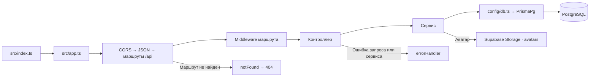
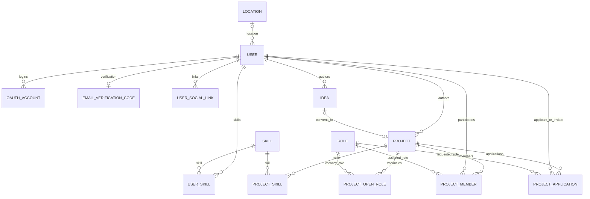

# Карта backend проекта

Срез рабочего дерева от 20 ноября 2026 года, базовый коммит `826b0a4` (Add applications). Backend IT-платформы для поиска проектов и участников команд. Основные источники для сверки поведения — маршруты в `src/routes`, сервисы в `src/services` и схема `prisma/schema.prisma`.

## Путь HTTP-запроса

- `index.ts` запускает Express на `PORT` (по умолчанию 4000). `app.ts` собирает маршруты, CORS для `CLIENT_URL` и обработчики ошибок.
- `requireAuth.ts` проверяет Bearer JWT и заполняет `req.userId`. Тип запроса расширен в `src/types/express.d.ts`. Проверка владения объектом и прав на бизнес-действия находится в сервисах.
- `requireInternalSecret.ts` проверяет заголовок `x-internal-secret` маршрута OAuth. `upload.ts` принимает multipart-файл `avatar` в память, до 4 МиБ, с MIME JPEG, PNG или WebP.
- Контроллеры читают параметры, тело и query, выполняют входную валидацию и выбирают HTTP-статус. `parseId.ts` разбирает положительные целые из строк. `AppError` передаёт свой статус в `errorHandler`, ошибки Multer дают 400, прочие ошибки дают 500. Формат ошибок — `{ error }`.
- `config/db.ts` создаёт общий Prisma Client с адаптером `@prisma/adapter-pg`. `config/jwt.ts`, `config/oauth.ts` и `config/supabase.ts` читают настройки при импорте. Маршрут health напрямую вызывает `prisma.user.count()`.

## Навигация по API

Все пути ниже относительны к `/api`. Имя модуля соответствует файлам `src/routes/<модуль>.routes.ts`, `src/controllers/<модуль>.controller.ts` и `src/services/<модуль>.service.ts`. Для заявок маршруты распределены между тремя модулями.

| Область | Маршруты | Основные модели и зависимости |
| --- | --- | --- |
| Health | `GET /health` | Проверка доступа к БД через подсчёт пользователей |
| Справочники | `GET /skills`, `GET /roles`, `GET /locations` | `Skill`, `Role`, `Location`. Начальные записи создаёт `prisma/seed.ts` через upsert |
| `auth` | `POST /auth/register`, `POST /auth/login`, `POST /auth/oauth`, `GET /auth/me` | `User`, `OAuthAccount`, bcrypt, JWT. Для `/oauth` нужен внутренний секрет, для `/me` нужен JWT |
| `user` | `GET /users/:username`, `PATCH /users/me`, `POST /users/me/avatar`, `PUT\|DELETE /users/me/skills/:skillId`, `PUT\|DELETE /users/me/socials/:platform` | `User`, `Location`, `UserSkill`, `UserSocialLink`, `ProjectMember`, Supabase. Профиль по username публичный |
| `project` | `GET\|POST /projects`, `GET\|PATCH\|DELETE /projects/:id`, `PUT\|DELETE /projects/:id/skills/:skillId`, `PUT\|DELETE /projects/:id/roles/:roleId`, `PATCH\|DELETE /projects/:id/members/{me или :userId}` | `Project`, `ProjectMember`, `ProjectSkill`, `ProjectOpenRole`. Чтение публичное, для изменений нужен JWT |
| `idea` | `GET\|POST /ideas`, `GET\|PATCH\|DELETE /ideas/:id`, `POST /ideas/:id/project` | `Idea` и `Project`. Чтение публичное. Редактирование, удаление и преобразование доступны автору |
| `application` | `GET\|POST /projects/:id/applications`, `POST /projects/:id/invitations`, `GET /users/me/applications`, `POST /applications/:id/accept`, `POST /applications/:id/decline`, `DELETE /applications/:id` | Все маршруты требуют JWT и используют `application.controller.ts` → `application.service.ts` → `ProjectApplication`, `ProjectOpenRole`, `ProjectMember` |

## Связи моделей

- Составные ключи фиксируют одного участника на пару пользователь–проект, одну вакансию на пару проект–роль, один уровень на пару владелец–навык и одну ссылку на пару пользователь–платформа.
- Удаление проекта каскадно удаляет участников, вакансии, проектные навыки и заявки. `Idea.projectId` сбрасывается в `null`. Удаление идеи сохраняет связанный проект.
- Модели без подключённого HTTP API: `Community` → `CommunityMember` и `Post` → `Comment`, `Team` → `TeamMember`, `TeamSkill`, `TeamApplication` и `HackathonTeam` → `Hackathon`. `Notification` ссылается на получателя через FK, а смысл `entityId` зависит от `type`. Сервисы заявок пока не создают уведомления.
- `Role` — справочник ролей в проекте. `AppRole` — системная роль пользователя. Доступ к операциям над конкретным проектом определяется его `authorId` и членством.

## Сквозные сценарии

### Аккаунт и профиль

Регистрация проверяет уникальность email и username, сохраняет bcrypt-хеш и возвращает пользователя. Вход по паролю и OAuth возвращают `{ token, user }` с JWT на семь дней. OAuth ищет связь по паре провайдер–ID аккаунта, затем по email, затем создаёт пользователя и связь. `auth/me` возвращает данные текущего пользователя, а публичный `users/:username` дополняет профиль городом, ссылками, навыками и участием в проектах.

`utils/publicUser.ts` задаёт исключение `email` и `passwordHash` для публичных выборок, в том числе вложенных пользователей в проектах, идеях и заявках. Auth-ответы и ответ загрузки аватара исключают хеш. `user.service.ts` пишет изображение в бакет Supabase `avatars` и сохраняет публичный URL в `User.avatarUrl`.

### Проект и идея

Создание проекта добавляет автора в участники с переданной ролью. Автор управляет карточкой, навыками, открытыми ролями и составом. Участник меняет собственный вклад и может выйти, если он не автор. Выход, исключение и смена роли участника сейчас не пересчитывают `slots`.

Ленты проектов и идей используют `{ items, total, page, limit }`. Проекты фильтруются по статусу, навыку, роли и подстроке в названии. Фильтр по роли учитывает только вакансии с `slots > 0`. `PROJECT_DETAILS_INCLUDE` в `project.service.ts` определяет подробную выборку и используется также при преобразовании идеи.

`convertIdeaToProject` проверяет автора, роль и отсутствие связанного проекта, затем в транзакции создаёт проект с автором-участником и обновляет `Idea.projectId`.

### Заявки и приглашения

`ProjectApplication.type` определяет направление. Для `REQUEST` пользователь подаёт заявку в проект со статусом `RECRUITMENT`, автор принимает или отклоняет. Для `INVITATION` автор приглашает пользователя, а решение принимает приглашённый. Отправитель может удалить запись, пока она в статусе `PENDING`. Статус проекта при приглашении не проверяется.

Создание проверяет членство, наличие свободного места и отсутствие другой ожидающей записи для этой пары пользователь–проект. Принятие атомарно меняет `PENDING` на `ACCEPTED`, уменьшает `slots` при положительном остатке и добавляет участника. Ошибка откатывает все три операции. Вакансия остаётся в проекте при нуле мест. Список проекта видит автор, список пользователя включает его заявки и входящие приглашения. Оба списка поддерживают фильтры `status` и `type`.

## Запуск, миграции и проверки

- `npm run dev` запускает `tsx watch` и читает `.env`. `npm run build` компилирует TypeScript из `src` в `dist`. `npm start` исполняет `dist/index.js` и получает окружение процесса.
- Для старта приложения нужны `DATABASE_URL`, `JWT_SECRET`, `CLIENT_URL`, `AUTH_INTERNAL_SECRET`, `SUPABASE_URL`, `SUPABASE_SERVICE_ROLE_KEY`. `.env.example` перечисляет только `PORT`, `DATABASE_URL`, `JWT_SECRET`.
- `prisma.config.ts` задаёт путь схемы и миграций и загружает окружение для CLI. После изменения схемы `prisma generate` обновляет игнорируемый `src/generated/prisma`. `dist` также исключён из Git.
- Миграции по порядку: начальная схема → детали проекта и открытые роли → OAuth → каскады проекта → ссылки профиля → верификация email. `docs/schema.dbml` отражает раннюю версию модели. Для актуальных полей и связей используется `prisma/schema.prisma`.
- `npm test` — заглушка. `scripts/test-applications.ts` проверяет жизненный цикл заявок по HTTP и состояние БД, включая параллельное принятие на последнее место. Скрипт требует работающего API, совпадающего подключения к тестовой БД и заполненных справочников. Создаёт и удаляет тестовые записи. Адрес задаётся `TEST_BASE_URL`, иначе берётся `PORT` с запасным значением 3000, тогда как API по умолчанию использует 4000.
- Для этого среза успешно прошли `tsc --noEmit` и `prisma validate`. Интеграционный сценарий и применение миграций к БД не выполнялись.

## Незавершённая верификация email

В рабочем дереве уже есть зависимость `resend`, поле `User.emailVerified` с default `false`, таблица `EmailVerificationCode` и миграция `20261118115121_email_verification`. На пользователя предусмотрен один код с хешем, сроком действия и счётчиком попыток. `src/config/email.ts` пуст. Auth-маршруты пока не отправляют и не проверяют код, а вход по паролю не проверяет `emailVerified`. По файлам миграций нельзя установить, какие миграции уже применены к развёрнутой БД.

## Что смотреть при изменениях

| Задача | Путь по коду |
| --- | --- |
| Изменить контракт списка или карточки | Соответствующий маршрут → контроллер и query → сервис с Prisma `include`, `select` и `omit` |
| Изменить права доступа | Middleware маршрута → проверки автора или участника в сервисе → статус ошибки в контроллере и `errorHandler` |
| Изменить правила набора | `application.service.ts` и `project.service.ts` → `ProjectOpenRole`, `ProjectMember`, `ProjectApplication` → `scripts/test-applications.ts` |
| Изменить преобразование идеи | `idea.service.ts` → транзакция и `PROJECT_DETAILS_INCLUDE` → связь `Idea.projectId` и миграция каскадов |
| Продолжить верификацию email | `auth.routes.ts`, `auth.controller.ts`, `auth.service.ts`, `config/email.ts` → `User` и `EmailVerificationCode` |
| Добавить поле или связь | `prisma/schema.prisma` → SQL-миграция и генерация Prisma → используемые выборки, ответы API и затронутые сценарии |

При изменении жизненного цикла заявок отдельно сверять конкурирующие переходы: принятие внутри транзакции проверяет `PENDING`, а отклонение и отзыв проверяют его чтением перед записью. Правило одной ожидающей заявки также проверяется в сервисе перед созданием. При изменении преобразования идеи учитывать, что проверка `Idea.projectId` выполняется перед транзакцией. Эти наблюдения сделаны по исходному коду.
